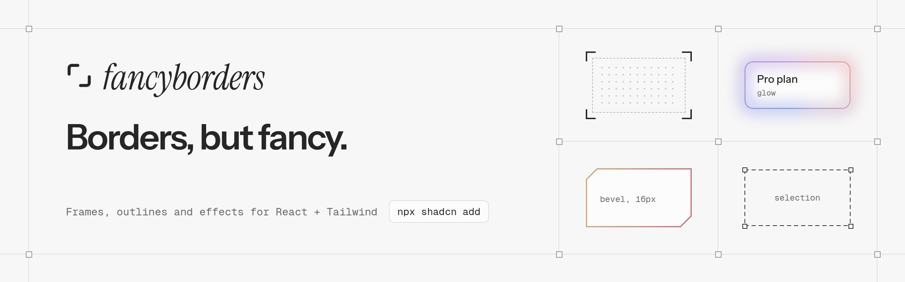

<h1 align="center">
  <picture>
    <source media="(prefers-color-scheme: dark)" srcset=".github/assets/banner-dark.png">
    
  </picture>
</h1>

<p align="center">
  <a href="https://fancyborders.vercel.app">Website</a> ·
  <a href="#install">Install</a> ·
  <a href="#whats-in-it">What's in it</a> ·
  <a href="#usage">Usage</a> ·
  <a href="#browser-support">Browser support</a> ·
  <a href="#development">Development</a>
</p>

Copy-paste frames, outlines and effects for React and Tailwind CSS.

**[fancyborders.vercel.app](https://fancyborders.vercel.app)** has every component running live, with controls to tune it, its code, and its props. Free and open source, forever.

## Install

Components install with the [shadcn CLI](https://ui.shadcn.com/docs/cli) into any React + Tailwind CSS v4 project. No `components.json` yet? Run `npx shadcn@latest init` first.

```bash
npx shadcn@latest add https://fancyborders.vercel.app/r/bracket-frame.json
```

The code lands in your project, along with anything it is built on and its CSS. It's yours to change.

## What's in it

| Kind | Items |
| --- | --- |
| **Frames** | `frame` (the primitive), `bracket-frame`, `hatch-divider` |
| **Structure** | `page-rails`, `section-rule`, `section-grid` |
| **Shapes** | `shape-frame`, `ticket-frame`, `folder-frame`, `bubble-frame`, `edge-frame` |
| **Effects** | `frame-effects` (gradient, glow, beam), `frame-spotlight`, `frame-metal`, `beam-frame`, `glow-frame` |

Swap the item name in the URL to install any of them. Line styles (dashes, marching ants) come with `frame`.

## Usage

Use a preset as a wrapper:

```tsx
import { BracketFrame } from "@/components/bracket-frame";

<BracketFrame className="p-5">
  <Card />
</BracketFrame>;
```

Or stack your own. Everything is a `Frame` with layers inside it; layers never affect layout, so the pieces combine:

```tsx
import { Frame, FrameCorners, FrameRules } from "@/components/ui/frame";
import { FrameGlow, FrameGradient } from "@/components/ui/frame-effects";

<Frame radius={14} className="p-6">
  <FrameRules overshoot={10} />
  <FrameCorners mark="plus" />
  <FrameGlow />
  <FrameGradient />
  Content
</Frame>;
```

Style it with Tailwind. Colour, line width, radius and effect colours are utilities, variants included:

```tsx
<Frame className="frame-line-2 frame-color-sky-500/50 hover:frame-color-sky-500 frame-from-indigo-300 frame-to-violet-400">
```

Effects work in light and dark mode. Every animation stops for people who prefer reduced motion. The [docs](https://fancyborders.vercel.app/docs) cover every component, layer, prop and utility.

## Browser support

Frames and page structure use widely supported CSS. Shape frames clip with `clip-path` and use `border-shape` where it exists (Chromium 147+); curved corners need CSS `shape()`. Beams need `offset-path` (Chromium 116, Firefox 122, Safari 18), and `frame-metal` needs WebGL. Each falls back to a plain border.

## Development

The site and the registry are one Next.js app.

```bash
bun install
bun dev                  # site at http://localhost:3000
bun run registry:build   # writes registry.json and public/r/*.json
bun run build            # registry, then the production build
```

| Path | What it holds |
| --- | --- |
| `src/components/ui/`, `src/components/` | The library: primitives with their CSS, and presets. |
| `registry/items.json` | The registry items. `scripts/build-registry.mjs` turns it into `registry.json`, then `shadcn build` writes `public/r/`. |
| `src/content/docs.ts` | Every component page and how the sidebar groups them. |
| `src/content/playgrounds/` | Each page's live preview: controls, render and printed code. |
| `src/content/api.ts`, `src/demos/` | Props tables, and examples shown running beside their source. |
| `src/components/site/` | The site itself: header, ⌘K search ([cmdk](https://cmdk.paco.me)), theme switch ([next-themes](https://github.com/pacocoursey/next-themes)), sidebar ([Animate UI](https://animate-ui.com)), code blocks, playground. |

Install commands use `NEXT_PUBLIC_SITE_URL`, falling back to the Vercel production URL and then `http://localhost:3000`.

**Adding a component:** build it from the primitives in `src/components/`, add it to `registry/items.json` (with what it `requires`), give it an entry in `src/content/docs.ts`, a playground and its props, then run `bun run registry:build` and test the install from `http://localhost:3000/r/<name>.json` in another project. The gallery, sidebar, search, landing page and sitemap pick it up on their own.

## Credits

The effects were inspired by Jakub Antalik's [Border Beam](https://libraries.dev/beam) and [Metal FX](https://github.com/Jakubantalik/metal-fx). The shader and palettes in `frame-metal` are adapted from Metal FX under the MIT License; see [THIRD_PARTY_NOTICES.md](./THIRD_PARTY_NOTICES.md).
